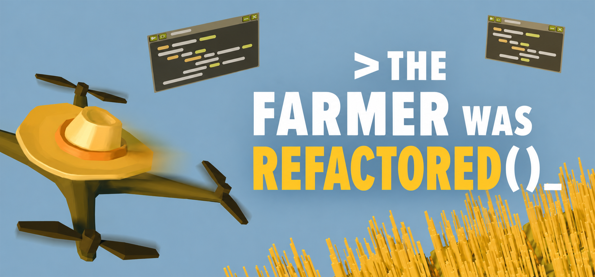

# The Farmer was Refactored

**Grow crops. Write TypeScript. Refactor the farm.**

An experimental language-system overhaul for **The Farmer Was Replaced**.
The goal: play in TypeScript, with an editor, execution controls, and in-game
lessons that teach the new language while preserving the farming mechanics.

[Progress & plans](PROJECT_STATUS.md) · [Development guide](docs/development.md) · [TypeScript example](examples/two-flips.ts)

> 🌱 **Still growing.** This is a development prototype, not a playable release.
> You can now run TypeScript from marked code windows through an opt-in
> diagnostic. The editor overhaul is unfinished, and there is no mod-store package.

## A little taste of the harvest

The source-input diagnostic can compile this and make the drone flip twice:

```typescript
// @refactored
const flipCount: number = 2;

for (let index = 0; index < flipCount; index++) {
  doAFlip();
}
```

Two flips. Strong types. One very enthusiastic drone.

Public APIs use TypeScript-style camelCase: `doAFlip()`, and eventually
`canHarvest()`. The latter is a planned name, not an implemented binding.
The `// @refactored` first line currently selects TypeScript execution; without
it, the game still uses its native language. It is a temporary diagnostic marker,
not part of TypeScript or the intended finished experience. With source mode
enabled, a single `doAFlip();` really does mean one flip.

The editor still uses Python highlighting. Marked TypeScript windows suppress
Python errors and show the first TypeScript compiler error after Run, with full
diagnostics in the BepInEx log. See the
[source-input test instructions](docs/design/typescript-source-input.md) for
setup, supported behavior, and limits; this is not a general-purpose farming mod yet.

## What's sprouted?

| Piece | Where it stands |
| --- | --- |
| Plugin startup | Verified in the isolated development game |
| JavaScript → native actions | Two flips and Stop verified in-game |
| TypeScript checking | Strict type checking and source-map emission tested |
| Embedded compiler | TypeScript in V8 verified under Unity/Mono |
| Compiled TypeScript → Jint → native actions | Completion and Stop verified in-game |
| Actual code-window source | One/three flips, repeated Run, type-error rejection, recovery, and Stop verified |
| TypeScript editor polish & rewritten lessons | Planned; Python indicators still appear |
| Full farming API, modules & drones | Planned |
| Playable release | Not yet |

The current test environment is **CachyOS Linux running the Windows game through
Proton**. Testing directly on Windows and macOS is still pending.
The working diagnostics do not yet establish full gameplay or timing parity.

## Pull on your development boots

For a fresh checkout, start with the [development guide](docs/development.md).
It covers the local SDK, game references, building, and an isolated game copy so
development stays separate from the normal installation.

Want to try just the compiler? With Node.js and npm installed:

```bash
npm ci --ignore-scripts --cache .tools/npm-cache
npm run test:compiler
```

That runs the 13 compiler tests without launching the game. Once the .NET/game
development prerequisites are set up, the
[TypeScript-to-Jint check](docs/design/typescript-jint-pipeline.md) tests the emitted
JavaScript against the staged runtime.

Node is a **development tool** used to prepare the compiler bundle. The verified
in-game diagnostic hosts TypeScript in ClearScript/V8 and executes the emitted
JavaScript in Jint; the game does not launch Node. Release packaging and the final
runtime choice remain open, including a known Jint labeled-loop issue tracked in
[project status](PROJECT_STATUS.md).

## Find your patch of the field

| Directory | What's inside |
| --- | --- |
| [src/Plugin](src/Plugin) | C# game integration and native action diagnostics |
| [src/Runtime](src/Runtime) | JavaScript runtime and command transport experiments |
| [src/V8Probe](src/V8Probe) | Embedded compiler and source-input diagnostics |
| [src/Compiler](src/Compiler) | TypeScript checking and JavaScript emission |
| [examples](examples) | TypeScript examples for the compiler prototype |
| [tests](tests) | Compiler, runtime, and integration checks |
| [docs/design](docs/design) | Architecture findings and diagnostic instructions |
| [docs/in-game](docs/in-game) | Future player lessons and reference material |
| [packaging](packaging) | Future release packaging |

## Help tend the project

Small, focused changes are welcome. We aim for **200–400 changed lines per PR**
when practical, and keep verification evidence separate from future plans.

Read [AGENTS.md](AGENTS.md) for working conventions and
[PROJECT_STATUS.md](PROJECT_STATUS.md) for the current handoff, decisions, bugs,
and next steps. Keep game binaries, saves, credentials, and local tools out of Git.

*The crops can stay. The snake_case is getting composted.*
